# Laboratorio 4: Trabajo integrador

**Materia:** DevOps — UCU
**Integrantes:** Alejandro Piccardo, Tomas Darracq, Diego Handalian
**Proyecto:** Calculadora API (FastAPI) con despliegue blue/green en Kubernetes

---

## 1. Contenerización (Docker)

### 1.a y 1.b Componentes y Dockerfiles

| Componente     | Imagen                   | Origen              |
| -------------- | ------------------------ | ------------------- |
| API v1 (blue)  | `calculadora:1.2`        | `app/v1/Dockerfile` |
| API v2 (green) | `calculadora:2.2`        | `app/v2/Dockerfile` |
| Prometheus     | `prom/prometheus:v3.1.0` | imagen oficial      |
| Grafana        | `grafana/grafana:11.5.0` | imagen oficial      |

### 1.c Requisitos de las imágenes

- **Versión específica:** `python:3.12.16-alpine3.24`, nunca `latest`.
- **Sin root:** `USER 10001`. Es numérico para que Kubernetes pueda verificar `runAsNonRoot`.
- **Multi-stage:** la etapa `build` instala las dependencias y la etapa final copia solo `/opt/venv`.

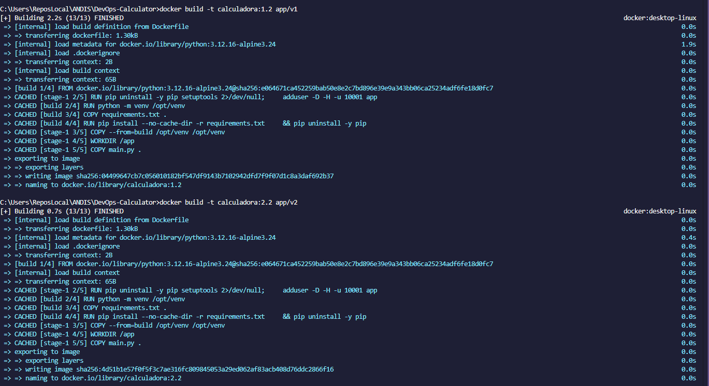

### 1.d Validación de calidad

**Vulnerabilidades (Trivy 0.76.1).** Se pasó de 47 vulnerabilidades HIGH sobre la base Debian a 0 de cualquier
severidad con Alpine. Evidencia: `reports/trivyreport.txt`, escaneo del 27/10/2026.

```bash
docker run --rm -v /var/run/docker.sock:/var/run/docker.sock aquasec/trivy:0.76.1 image --severity HIGH,CRITICAL calculadora:2.2
```

**Tamaño y capas (Dive v0.13.1).**

```bash
./scripts/analizar-imagenes.sh
```

```
Tamano (bytes): 70733461
Capas del filesystem: 8
  efficiency: 99.5877 %
  wastedBytes: 513248 bytes (513 kB)
  userWastedPercent: 0.8240 %
Result:PASS [Total:3] [Passed:2] [Failed:0] [Warn:0] [Skipped:1]
```

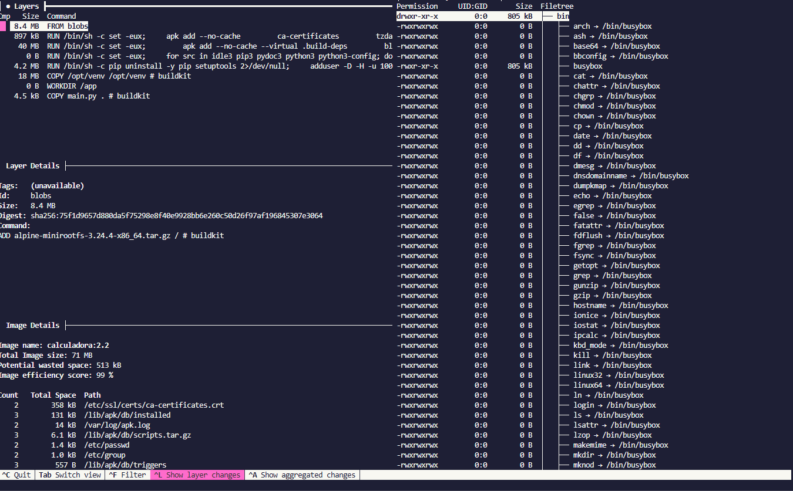

### 1.e Reporte

El tamaño total, la cantidad de capas y las optimizaciones posibles están en `reports/image-analysis.md`.

| Dato         | `calculadora:1.2` | `calculadora:2.2` |
| ------------ | ----------------- | ----------------- |
| Tamaño total | 70,7 MB           | 70,7 MB           |
| Capas        | 8                 | 8                 |
| Eficiencia   | 99,59 %           | 99,59 %           |

---

## 2. Orquestación y despliegue (Kubernetes)

Helm era opcional según lo indicado por la cátedra, por lo que la aplicación se despliega con manifiestos de
Kubernetes.

| Recurso                 | Archivo                                                 |
| ----------------------- | ------------------------------------------------------- |
| Deployment blue y green | `k8s/deployment-blue.yaml`, `k8s/deployment-green.yaml` |
| Service (NodePort)      | `k8s/service.yaml`                                      |
| ConfigMap por entorno   | `k8s/configmap.yaml`                                    |

No se usa Ingress: es un solo servicio HTTP y se accede por el NodePort.

```bash
kubectl apply -f k8s/
```

### 2.e Verificación

```
$ kubectl get pods -l app=calculadora
NAME                                 READY   STATUS    RESTARTS   AGE
calculadora-blue-86ccfcbff-5qjw2     1/1     Running   0          2m11s
calculadora-blue-86ccfcbff-pxcwr     1/1     Running   0          2m19s
calculadora-green-655f99497f-65qbp   1/1     Running   0          2m19s
calculadora-green-655f99497f-w6cmv   1/1     Running   0          2m11s

$ kubectl get svc calculadora
NAME          TYPE       CLUSTER-IP     EXTERNAL-IP   PORT(S)        AGE
calculadora   NodePort   10.104.85.27   <none>        80:30080/TCP   12d

$ kubectl port-forward svc/calculadora 18081:80
$ curl "http://127.0.0.1:18081/suma?a=2&b=3"
{"operacion":"suma","resultado":5.0,"version":"1.2","color":"blue"}
```

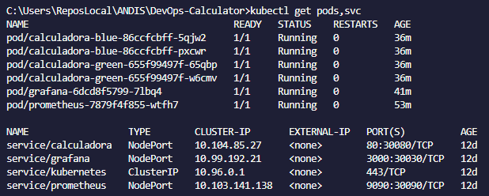

---

## 3. Integración y entrega continua (Jenkins)

<!-- SECCIÓN LIBRE: la completa el compañero a cargo de Jenkins. -->

### 3.a Pipeline en Jenkins

### 3.b Etapas del pipeline

### 3.c Jenkinsfile

### 3.d Ejecución y registros de cada fase

### 3.e Detención ante vulnerabilidades críticas

---

## 4. Monitoreo y observabilidad (Prometheus + Grafana)

### 4.a y 4.b Instrumentación

La aplicación expone `GET /metrics` con `prometheus-client`.

| Métrica                           | Tipo       | Uso                                      |
| --------------------------------- | ---------- | ---------------------------------------- |
| `calculadora_peticiones_segundos` | Histograma | RPS y latencia promedio                  |
| `calculadora_operaciones_total`   | Contador   | Métrica de negocio: operaciones por tipo |
| `calculadora_errores_total`       | Contador   | Operaciones rechazadas, por motivo       |

`/metrics` y `/health` no se miden, porque los consultan Prometheus y las probes cada pocos segundos y
falsearían el RPS.

### 4.c Prometheus

Se despliega en el cluster con `monitoring/prometheus.yaml` y tiene dos jobs: `calculadora`, que descubre los
pods anotados, y `cadvisor`, que obtiene CPU y memoria por pod.

```bash
kubectl apply -f monitoring/
./scripts/abrir-monitoreo.sh     # Prometheus en :9090, Grafana en :3000
```

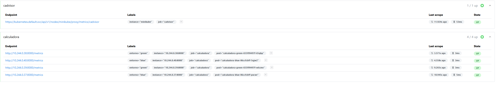

### 4.d Grafana

Se despliega con `monitoring/grafana.yaml` y usa Prometheus como fuente de datos (`http://prometheus:9090`).

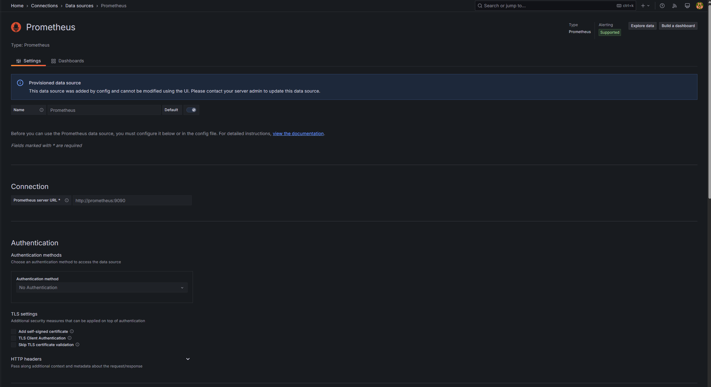

### 4.e Dashboard

| Requisito          | Consulta                                                                                                    |
| ------------------ | ----------------------------------------------------------------------------------------------------------- |
| RPS                | `sum by (version) (rate(calculadora_peticiones_segundos_count[1m]))`                                        |
| Latencia promedio  | `sum(rate(calculadora_peticiones_segundos_sum[1m])) / sum(rate(calculadora_peticiones_segundos_count[1m]))` |
| CPU por pod        | `sum by (pod) (rate(container_cpu_usage_seconds_total{pod=~"calculadora-.*"}[1m]))`                         |
| Memoria por pod    | `sum by (pod) (container_memory_working_set_bytes{pod=~"calculadora-.*"})`                                  |
| Métrica de negocio | `sum by (operacion) (rate(calculadora_operaciones_total[1m])) * 60`                                         |

Valores obtenidos con `./scripts/generar-carga.sh`:

```
RPS:      2.09
Latencia: 0.00425 s (4,25 ms)
Memoria:  ~37 MB por pod
Alertas:  DemasiadasOperaciones y DemasiadasOperacionesInvalidas en firing
```

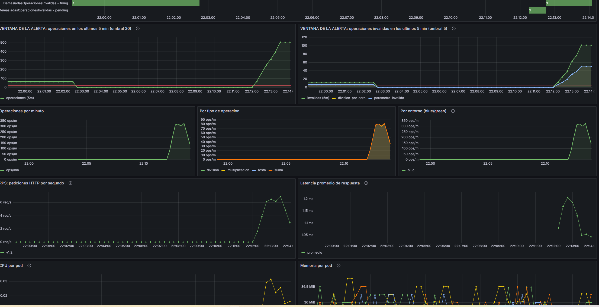

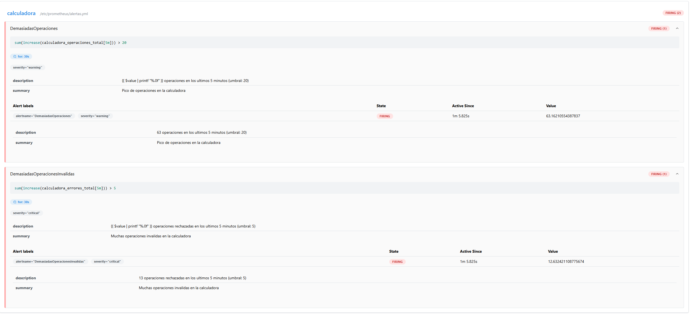

### 4.f Exportación

Dashboard exportado en `grafana/dashboard.json`.

---

## 5. Seguridad integrada (DevSecOps)

### 5.1 Análisis estático (Semgrep)

```bash
./scripts/escanear-semgrep.sh
```

Se aplican los rulesets `p/python`, `p/dockerfile`, `p/kubernetes`, `p/secrets` y `p/security-audit`, y tres
reglas propias para Python en `semgrep/reglas-python.yaml`:

| Regla                          | Detecta                       | CWE     |
| ------------------------------ | ----------------------------- | ------- |
| `calculadora-eval-exec`        | `eval()` y `exec()`           | CWE-95  |
| `calculadora-subprocess-shell` | `subprocess` con `shell=True` | CWE-78  |
| `calculadora-fastapi-debug`    | `FastAPI(debug=True)`         | CWE-489 |

```
Ran 258 rules on 13 files: 0 findings.
```

**Hallazgos corregidos:** los 6 hallazgos iniciales estaban en los manifiestos (`run-as-non-root` y
`writable-filesystem-container`) y se corrigieron con `securityContext`.

**Lo que se mantiene, con justificación:**

- `uvicorn --host 0.0.0.0`: dentro de un contenedor es necesario para que el Service llegue al pod.
- Clave de demo de Grafana en un Secret versionado: es solo para minikube; en un entorno real iría en un gestor
  de secretos.

Reporte completo: `reports/semgrep-report.txt`.

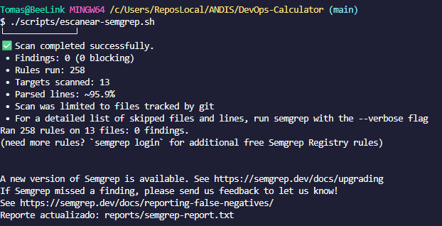

### 5.2 Escaneo de dependencias (Snyk)

```bash
SNYK_TOKEN=xxxx ./scripts/escanear-snyk.sh
```

Se escanearon las dependencias de las dos versiones de la aplicación. Evidencia: `reports/snyk-report.txt`.

```
Tested 15 dependencies for known issues, found 0 issues, 0 vulnerable paths.
Open Security issues: 0
```

**Vulnerabilidades críticas:** no hay ninguna abierta. El antecedente es `starlette 0.41.3`, con 7
vulnerabilidades detectadas por `pip-audit` (`reports/npm-audit.txt`). Se corrigió actualizando `fastapi` a
0.162.0 y fijando `starlette` en 1.10.0 en `requirements.txt`, para que una versión vulnerable no pueda entrar
por la resolución transitiva.

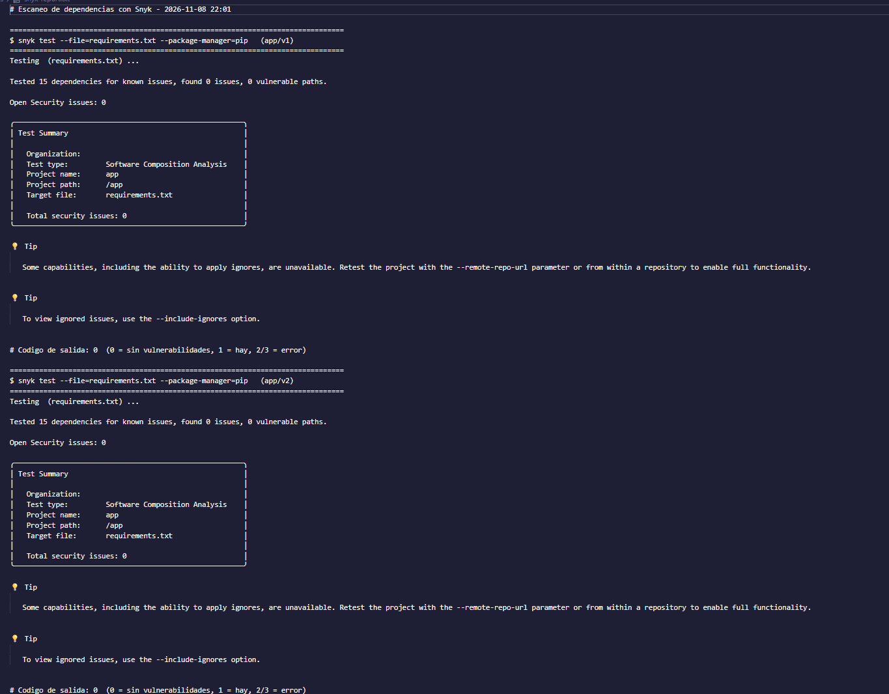

### 5.3 Políticas de seguridad en Kubernetes (Kyverno)

Kyverno 1.19.2 con cuatro `ValidatingPolicy` en modo `Deny`, en `kyverno/politicas/`:

| #   | Política                 | Rechaza                                               |
| --- | ------------------------ | ----------------------------------------------------- |
| 1   | `prohibir-tag-latest`    | Imágenes `latest` o sin tag                           |
| 2   | `exigir-requests-limits` | Contenedores sin requests y limits de CPU y memoria   |
| 3   | `prohibir-root`          | Contenedores que corren como root                     |
| 4   | `prohibir-privilegiados` | `privileged: true` o `allowPrivilegeEscalation: true` |

La política 4 es la adicional: un contenedor privilegiado casi no tiene aislamiento con el nodo.

```bash
./scripts/validar-kyverno.sh
```

```
Policy prohibir-tag-latest failed: No se permite la etiqueta latest ni imagenes sin tag. Contenedores: app (calculadora:latest)
Policy exigir-requests-limits failed: Todos los contenedores deben declarar requests y limits de cpu y memory. Contenedores: app
Policy prohibir-root failed: Los contenedores no pueden correr como root: se requiere runAsNonRoot: true y runAsUser distinto de 0. Contenedores: app
Policy prohibir-privilegiados failed: No se permiten contenedores privilegiados ni con allowPrivilegeEscalation: true. Contenedores: app

$ kubectl apply -f kyverno/pruebas/conforme.yaml
pod/prueba-conforme created
```

Los 5 objetos no conformes se rechazan, el Pod conforme se acepta y los manifiestos del proyecto pasan el dry-run
en el servidor. Evidencia: `reports/kyverno-validation.log`.

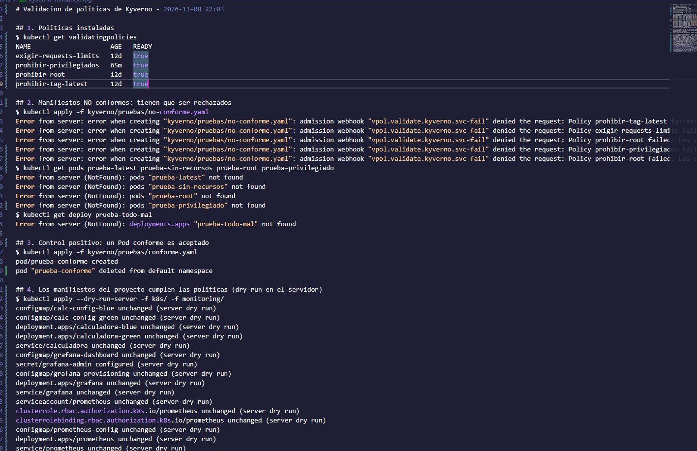

### 5.4 Seguridad en tiempo de ejecución (Falco)

Falco 0.45.1 instalado con el chart oficial y el driver `modern_ebpf`:

```bash
helm install falco falco --repo https://falcosecurity.github.io/charts --version 9.2.1 -n falco --create-namespace -f falco/values.yaml
./scripts/disparar-falco.sh
```

**Evento detectado:** el Pod `prueba-falco` ejecuta `find /etc -name id_rsa`, como haría un atacante que busca
claves privadas dentro de un contenedor comprometido. No se abre ningún shell: `find` es directamente el comando
del contenedor. Falco lo detecta con la regla por defecto **Search Private Keys or Passwords**, de prioridad
Warning.

```
Warning Grep private keys or passwords activities found | evt_type=execve user_uid=10001 process=find
proc_exepath=/bin/busybox parent=containerd-shim command=find /etc -name id_rsa terminal=0
```

Evidencia: `reports/falco-event.log`.

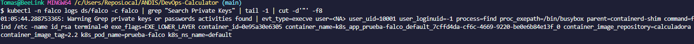

---

## 6. Reporte técnico final

### 6.a Descripción general

API REST de una calculadora, desarrollada con FastAPI, con dos versiones que conviven en el cluster. El cambio de
versión consiste en mover el `selector` del Service de blue a green. El proyecto suma monitoreo con Prometheus y
Grafana y controles de seguridad en el código, la imagen, el cluster y la ejecución.

### 6.b Arquitectura final

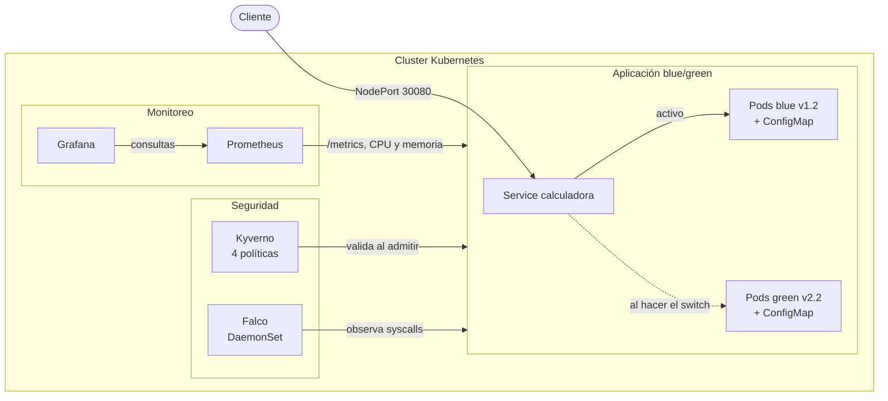

### 6.c Pipeline implementado

<!-- SECCIÓN LIBRE: la completa el compañero a cargo de Jenkins. -->

### 6.d Métricas y dashboard de Grafana

Ver la sección 4. El dashboard exportado se adjunta en `grafana/dashboard.json`.

### 6.e Resultados de análisis de seguridad

| Herramienta | Resultado                                                     | Evidencia                        |
| ----------- | ------------------------------------------------------------- | -------------------------------- |
| Semgrep     | 258 reglas (3 propias), 0 hallazgos; 6 corregidos             | `reports/semgrep-report.txt`     |
| Snyk        | 15 dependencias por versión, 0 vulnerabilidades               | `reports/snyk-report.txt`        |
| Trivy       | De 47 HIGH a 0 vulnerabilidades                               | `reports/trivyreport.txt`        |
| Kyverno     | 4 políticas en `Deny`; 5 objetos rechazados y 1 aceptado      | `reports/kyverno-validation.log` |
| Falco       | Alerta `Search Private Keys or Passwords`, sin abrir un shell | `reports/falco-event.log`        |

### 6.f Problemas encontrados y soluciones

| Problema                                                                      | Solución                                                                      |
| ----------------------------------------------------------------------------- | ----------------------------------------------------------------------------- |
| 44 CVE HIGH sin parche en la base Debian                                      | Cambio a Alpine con build multi-stage                                         |
| La evidencia inicial de Falco era abrir un shell, algo no permitido           | Pod que ejecuta `find` y dispara una regla por defecto                        |
| `minikube image load` no reemplaza un tag existente y quedaba la imagen vieja | Borrar el tag dentro de minikube antes de cargar                              |
| Las consultas de CPU y memoria volvían vacías                                 | cAdvisor no publica el label `container` en este entorno: se filtra por `pod` |
| Una URL inventada podía crear series nuevas en Prometheus                     | El label `path` usa la ruta declarada, con `no_encontrada` como respaldo      |

### 6.g Conclusiones y oportunidades de mejora

Combinar controles en distintas capas permitió detectar problemas que una sola herramienta no veía: Semgrep marcó
los manifiestos, Trivy la imagen base y Kyverno impide que esas fallas vuelvan al cluster.

Como mejoras quedan guardar la clave de Grafana en un gestor de secretos, dar almacenamiento persistente a
Prometheus y agregar Alertmanager para que las alertas lleguen a alguien.

---

## Consideraciones adicionales

### a) y b) Scripts

| Script                           | Función                                                               |
| -------------------------------- | --------------------------------------------------------------------- |
| `scripts/iniciar.sh`             | Levanta minikube, imágenes, operadores, aplicación, monitoreo y carga |
| `scripts/instalar-operadores.sh` | Instala Kyverno y Falco y aplica las políticas                        |
| `scripts/generar-carga.sh`       | Hace solicitudes automáticas para poblar los dashboards               |
| `scripts/abrir-monitoreo.sh`     | Expone Grafana y Prometheus en localhost                              |
| `scripts/limpiar.sh`             | Borra todos los recursos (`--todo` borra también minikube)            |

<!-- El compañero a cargo de Jenkins agrega acá el script que inicia Jenkins. -->

### c) Documentación paso a paso

| Sección    | Documento               |
| ---------- | ----------------------- |
| Docker     | `docs/01-docker.md`     |
| Kubernetes | `docs/02-kubernetes.md` |
| Monitoreo  | `docs/04-monitoreo.md`  |
| Seguridad  | `docs/05-seguridad.md`  |
