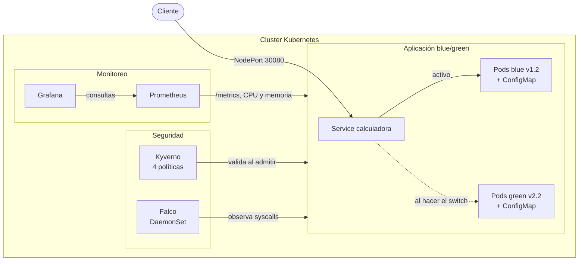

# Laboratorio 4 — Calculadora API con enfoque DevOps y DevSecOps

**Materia:** DevOps — UCU
**Integrantes:** Alejandro Piccardo, Tomas Darracq, Diego Handalian

---

# Reporte técnico final

## a. Descripción general

API REST de una calculadora (FastAPI) desplegada en Kubernetes con estrategia blue/green, monitoreada con
Prometheus y Grafana y protegida con controles automáticos de seguridad en código, imagen, cluster y
ejecución. El detalle de la aplicación está en la sección 1 de este documento.

**Paso a paso por sección de la consigna:**

| Sección                     | Documento                                          |
|-----------------------------|----------------------------------------------------|
| 1. Docker                   | [`docs/01-docker.md`](docs/01-docker.md)           |
| 2. Kubernetes               | [`docs/02-kubernetes.md`](docs/02-kubernetes.md)   |
| 3. Pipeline con Jenkins     | [`docs/06-jenkins.md`](docs/06-jenkins.md)         |
| 4. Prometheus y Grafana     | [`docs/04-monitoreo.md`](docs/04-monitoreo.md)     |
| 5. Semgrep, Snyk, Kyverno, Falco | [`docs/05-seguridad.md`](docs/05-seguridad.md) |

**Inicio rápido:**

```bash
./scripts/iniciar.sh          # minikube, imágenes, Kyverno, Falco, app, monitoreo y carga
./scripts/abrir-monitoreo.sh  # Grafana y Prometheus en localhost
./scripts/generar-carga.sh    # más tráfico para los dashboards
./scripts/limpiar.sh          # borra los recursos (--todo borra también minikube)
```

Requisitos: Docker, kubectl, minikube y Helm.

> **Dónde se despliega.** Hay dos destinos y no se mezclan:
>
> | Destino | Cuándo | Cómo |
> |---|---|---|
> | **minikube**, en tu máquina | Entregas 1 a 3: desarrollo, monitoreo, Kyverno, Falco | `kubectl apply` + `minikube image load` (secciones 3 a 8) |
> | **Cluster UCU**, remoto | Entrega 4: el despliegue real | Jenkins + Helm, imagen desde DockerHub (sección 9) |
>
> Los comandos de `minikube` de este README siguen siendo válidos para el camino local. En el cluster
> de la UCU no aplican: no hay `minikube image load` ni NodePort. Ver
> [`docs/06-jenkins.md`](docs/06-jenkins.md).

## b. Arquitectura final



## c. Pipeline implementado

Pipeline de Jenkins definido en [`Jenkinsfile`](Jenkinsfile), con siete etapas. Las etapas 2 y 3
**detienen la ejecución y reportan el error** ante hallazgos críticos, que es lo que pide el punto 3.e
de la consigna.

| # | Etapa | Herramienta | Corta el pipeline si... |
|---|---|---|---|
| 1 | Clonar repositorio | git | no puede clonar |
| 2 | Análisis estático | Semgrep | hay hallazgos de severidad `ERROR` |
| 3 | Dependencias | Snyk | hay vulnerabilidades **críticas** |
| 4 | Construcción y test | pytest (23 tests) | falla algún test |
| 5 | Imagen Docker | docker | falla el build o el push a DockerHub |
| 6 | Despliegue | Helm | el rollout no queda listo en 5 min |
| 7 | Smoke test | kubectl + curl | el Service no responde |

Cada etapa deja su log en la consola de Jenkins, y los informes completos quedan archivados como
artefactos del build (`reports/`). El despliegue va al **cluster remoto de la UCU**, no a minikube.
Puesta en marcha, credenciales y detalle en [`docs/06-jenkins.md`](docs/06-jenkins.md).

## d. Métricas y dashboard de Grafana

El dashboard exportado es [`grafana/dashboard.json`](grafana/dashboard.json) y muestra RPS, latencia promedio,
CPU y memoria por pod y operaciones por tipo (métrica de negocio). Valores medidos bajo carga: 2,09 RPS, 4,25 ms
de latencia promedio y unos 37 MB de memoria por pod. Ver [`docs/04-monitoreo.md`](docs/04-monitoreo.md).

## e. Resultados de seguridad

| Herramienta | Resultado                                                                 | Evidencia                         |
|-------------|---------------------------------------------------------------------------|-----------------------------------|
| Semgrep     | 258 reglas (3 propias), 0 hallazgos; 6 corregidos                         | `reports/semgrep-report.txt`      |
| Snyk        | 15 dependencias por versión, 0 vulnerabilidades                           | `reports/snyk-report.txt`         |
| Trivy       | De 47 HIGH a 0 vulnerabilidades                                           | `reports/trivyreport.txt`         |
| Dive        | 70,7 MB, 8 capas, eficiencia 99,59 %                                      | `reports/image-analysis.md`       |
| Kyverno     | 4 políticas en `Deny`; 5 objetos rechazados, 1 aceptado                   | `reports/kyverno-validation.log`  |
| Falco       | Alerta `Search Private Keys or Passwords`, sin abrir un shell             | `reports/falco-event.log`         |

## f. Problemas encontrados y soluciones

| Problema                                                                       | Solución                                                                 |
|--------------------------------------------------------------------------------|--------------------------------------------------------------------------|
| 44 CVE HIGH sin parche en la base Debian                                       | Cambio a Alpine con build multi-stage                                    |
| La evidencia de Falco era abrir un shell, prohibido por la consigna            | Pod que ejecuta `find` y dispara una regla por defecto                   |
| `minikube image load` no reemplaza un tag existente y quedaba la imagen vieja  | Borrar el tag dentro de minikube antes de cargar (`iniciar.sh`)          |
| Las consultas de CPU y memoria volvían vacías                                  | cAdvisor no publica el label `container` acá: se filtra por `pod`        |
| Una URL inventada podía crear series nuevas en Prometheus                      | El label `path` usa la ruta declarada, con `no_encontrada` como respaldo |

## g. Conclusiones y oportunidades de mejora

Integrar los controles en distintas capas permitió detectar problemas que una sola herramienta no veía: Semgrep
y KubeLinter marcaron los manifiestos, Trivy la imagen base y Kyverno impide que esas fallas vuelvan al cluster.

Oportunidades de mejora: guardar la clave de Grafana en un gestor de secretos, dar almacenamiento persistente a
Prometheus y agregar Alertmanager para que las alertas notifiquen a alguien.

---

## 1. Descripción

API REST de una calculadora, contenerizada con Docker y desplegada en Kubernetes (minikube).

Se desarrollaron 2 versiones de la aplicación y se alterna entre ellas usando la estrategia
**blue/green**: ambos entornos conviven en el cluster y el cambio de versión consiste únicamente en
mover el `selector` del Service de un entorno al otro.

| Entorno   | Imagen            | Versión | Operaciones                            |
|-----------|-------------------|---------|----------------------------------------|
| **blue**  | `calculadora:1.2` | 1.2     | suma, resta, multiplicación, división  |
| **green** | `calculadora:2.2` | 2.2     | idem + raíz cuadrada     |

El cambio mínimo entre versiones es el agregado del endpoint `/raiz`. Todos los endpoints de la v1 siguen funcionando igual en la v2.

### Endpoints

| Método | Endpoint                  | v1 (blue) | v2 (green) | Descripción                          |
|--------|---------------------------|-----------|------------|--------------------------------------|
| GET    | `/`                       | sí        | sí         | Versión, color y operaciones activas |
| GET    | `/health`                 | sí        | sí         | Usado por las probes de Kubernetes   |
| GET    | `/metrics`                | sí        | sí         | Métricas en formato Prometheus       |
| GET    | `/suma?a=2&b=3`           | sí        | sí         | a + b                                |
| GET    | `/resta?a=5&b=2`          | sí        | sí         | a - b                                |
| GET    | `/multiplicacion?a=3&b=4` | sí        | sí         | a * b                                |
| GET    | `/division?a=10&b=2`      | sí        | sí         | a / b (400 si b = 0)                 |
| GET    | `/raiz?a=9`               | **404**   | sí         | raíz de a (400 si a < 0)             |

Toda respuesta incluye los campos `version` y `color`, así se ve al instante qué entorno está
atendiendo el pedido:

```json
{"operacion":"suma","resultado":5.0,"version":"1.1","color":"blue"}
```

---

## 2. Estructura del proyecto

```
Entrega1/
├── app/
│   ├── v1/                     # versión 1.0 (sin raíz cuadrada)
│   │   ├── main.py
│   │   ├── requirements.txt
│   │   └── Dockerfile
│   └── v2/                     # versión 2.0 (con raíz cuadrada)
│       ├── main.py
│       ├── requirements.txt
│       └── Dockerfile
├── k8s/
│   ├── configmap.yaml          # configuración de cada entorno
│   ├── deployment-blue.yaml    # Deployment blue  -> calculadora:1.2
│   ├── deployment-green.yaml   # Deployment green -> calculadora:2.2
│   └── service.yaml            # Service NodePort con selector conmutable
├── monitoring/                 # Entrega 2
│   ├── prometheus.yaml         # RBAC + config + reglas de alerta + Deployment + Service
│   ├── grafana.yaml            # Secret + provisioning + Deployment + Service
│   └── grafana-dashboard.yaml  # el dashboard en JSON
├── grafana/
│   └── dashboard.json          # dashboard exportado (RPS, latencia, CPU/memoria por pod, negocio)
├── scripts/
│   ├── iniciar.sh              # levanta todo (minikube, imagenes, Kyverno, Falco, app, monitoreo)
│   ├── abrir-monitoreo.sh      # expone Grafana y Prometheus en localhost
│   ├── analizar-imagenes.sh    # Dive: tamano y capas
│   ├── escanear-semgrep.sh     # actualiza reports/semgrep-report.txt
│   ├── escanear-snyk.sh        # genera reports/snyk-report.txt (requiere SNYK_TOKEN)
│   ├── instalar-operadores.sh  # instala Kyverno y Falco + aplica las politicas
│   ├── generar-carga.sh        # trafico para poblar los dashboards (bash)
│   ├── generar-carga.ps1       # idem para PowerShell
│   ├── validar-kyverno.sh      # prueba las politicas y escribe reports/kyverno-validation.log
│   ├── disparar-falco.sh       # dispara la alerta de Falco y escribe reports/falco-event.log
│   └── limpiar.sh              # borra todos los recursos (--todo borra tambien minikube)
├── kyverno/                    # Entrega 3
│   ├── politicas/              # las 4 ValidatingPolicy
│   └── pruebas/                # manifiestos conforme / no conforme
├── falco/
│   ├── values.yaml             # values del chart de Helm de Falco
│   └── prueba-falco.yaml       # Pod que dispara la alerta (sin shell)
├── semgrep/
│   └── reglas-python.yaml      # reglas de seguridad propias
├── docs/                       # paso a paso de cada seccion de la consigna
├── reports/                    # evidencia de la entrega 3 (ver sección 7)
└── README.md
```

Las dos versiones se mantienen en carpetas separadas para que ambas imágenes puedan reconstruirse
desde cero, sin depender del historial de git.

**Stack:** Python 3.12 + FastAPI + Uvicorn · Docker · Kubernetes (minikube).

---

## 3. Requisitos previos

Para el camino **local** (secciones 4 a 8): Docker, kubectl, minikube y Helm.

```bash
minikube start
```

```bash
kubectl get nodes
```

Para el camino del **cluster de la UCU** (sección 9) no hace falta minikube: Jenkins corre en un
contenedor con kubectl y Helm adentro, y se autentica con el kubeconfig del grupo. Si lo querés usar a
mano desde tu terminal:

```bash
export KUBECONFIG=$HOME/.kube/ucu.yaml
```

```bash
kubectl get pods -n obligatorio-grupo5
```

> El kubeconfig **no está en el repo**: contiene un token de acceso al cluster. Vive en
> `~/.kube/ucu.yaml` y está en el `.gitignore`.

---

## 4. Despliegue paso a paso (minikube, local)

Este es el camino **local**. Para el cluster de la UCU, ver la sección 9.

### Paso 1 — Construir las imágenes

Desde la carpeta `Entrega1/`:

```bash
docker build -t calculadora:1.2 app/v1
```

```bash
docker build -t calculadora:2.2 app/v2
```

### Paso 2 — Cargar las imágenes en minikube

minikube corre en su propio nodo y no ve las imágenes del Docker local, por lo que hay que
cargarlas explícitamente:

```bash
minikube image load calculadora:1.2
```

```bash
minikube image load calculadora:2.2
```


En los Deployments se usa `imagePullPolicy: IfNotPresent` para que Kubernetes use la imagen local y
no intente descargarla de Docker Hub.

### Paso 3 — Desplegar ambos entornos

```bash
kubectl apply -f k8s/
```

Esto crea los dos ConfigMaps, los dos Deployments (2 réplicas cada uno) y el Service.
**Los dos entornos quedan corriendo al mismo tiempo**, pero el Service apunta solo a blue.

```bash
kubectl get pods -l app=calculadora -L version
```

```
NAME                                 READY   STATUS    RESTARTS   AGE   VERSION
calculadora-blue-68d89f4754-rksbc    1/1     Running   0          14s   blue
calculadora-blue-68d89f4754-sm82h    1/1     Running   0          14s   blue
calculadora-green-649ccd6fc5-g5s5d   1/1     Running   0          14s   green
calculadora-green-649ccd6fc5-xmvj2   1/1     Running   0          14s   green
```

Aunque hay 4 pods corriendo, el Service solo tiene como endpoints a los 2 de blue:

```bash
kubectl get endpointslice -l kubernetes.io/service-name=calculadora
```

### Paso 4 — Acceder a la aplicación

```bash
minikube service calculadora --url
```

Devuelve una URL tipo `http://127.0.0.1:59493`. **Dejar esa terminal abierta** (con el driver
`docker` en Windows, la terminal mantiene abierto el túnel) y usar otra para las pruebas.

```bash
curl "http://127.0.0.1:59493/"
```

```bash
curl "http://127.0.0.1:59493/suma?a=2&b=3"
```

```bash
curl "http://127.0.0.1:59493/raiz?a=9"
```

Salida:

```
{"app":"calculadora","version":"1.2","color":"blue","operaciones":["suma","resta","multiplicacion","division"]}
{"operacion":"suma","resultado":5.0,"version":"1.2","color":"blue"}
{"detail":"Not Found"}
```

`/raiz` devuelve 404 porque la v1 no tiene esa operación.

> **Por qué no usar `kubectl port-forward svc/calculadora` para la demo:** el port-forward elige un
> pod al establecer la conexión y se queda pegado a él, así que **no refleja el cambio de selector**.
> `minikube service` pasa por el NodePort y kube-proxy, que resuelve los endpoints en cada conexión;
> por eso es la forma correcta de demostrar el switch.

### Paso 5 — Validar green antes de darle tráfico


### Paso 6 — Switch blue -> green

Todo el despliegue se reduce a cambiar el selector del Service.

**PowerShell (Windows):**

```bash
kubectl patch service calculadora -p '{\"spec\":{\"selector\":{\"app\":\"calculadora\",\"version\":\"green\"}}}'
```

Consultando **la misma URL de antes**, sin reiniciar ni redesplegar nada:

```
{"app":"calculadora","version":"2.2","color":"green","operaciones":["suma","resta","multiplicacion","division","raiz"]}
{"operacion":"raiz","resultado":3.0,"version":"2.2","color":"green"}
```


### Paso 7 — Rollback

Si se detecta un error en producción con la v2, el rollback es el mismo patch al revés:

```bash
kubectl patch service calculadora -p '{\"spec\":{\"selector\":{\"app\":\"calculadora\",\"version\":\"blue\"}}}'
```

### Paso 8 — Limpieza

```bash
kubectl delete -f k8s/
```

---

## 5. Decisiones técnicas

- **Dos Deployments + un Service.** Es la implementación canónica de blue/green: los entornos son
  independientes y se distinguen por la label `version: blue|green`. El Service es el único punto de
  entrada estable, y el switch es un cambio de una sola línea, atómico y reversible.

- **Un ConfigMap por entorno.** `APP_VERSION` y `APP_COLOR` se inyectan con `envFrom.configMapRef`
  en lugar de estar hardcodeados en el código, que es el uso que corresponde a un ConfigMap.

- **Readiness y liveness probes sobre `/health`.** La readiness probe es lo que hace *seguro* el
  blue/green: Kubernetes solo agrega un pod a los endpoints del Service cuando responde
  correctamente, así que al conmutar el selector no hay riesgo de mandar tráfico a un pod que
  todavía está arrancando.

- **`type: NodePort`.** Es el tipo de Service más simple que funciona en minikube sin componentes
  extra (un `LoadBalancer` requeriría `minikube tunnel`).

- **`replicas: 2` en cada entorno.** Suficiente para mostrar que el Service balancea entre varios
  pods, sin consumir recursos de más en un cluster local.

---

## 6. Monitoreo y alertas (Entrega 2)

La calculadora expone métricas en `/metrics`, Prometheus las recolecta y evalúa dos reglas de
alerta, y Grafana las muestra en un dashboard. **No se usa Alertmanager**: las alertas se visualizan,
no se notifican (ver "Alcance" más abajo).

```
┌──────────────┐  /metrics   ┌────────────────────────┐  consulta   ┌─────────┐
│ calculadora  │ ──────────> │ Prometheus             │ ──────────> │ Grafana │
│ (4 pods)     │  cada 15 s  │  · guarda las métricas │             │         │
└──────────────┘             │  · evalúa las reglas   │             └─────────┘
                             │  · publica ALERTS{...} │
                             └────────────────────────┘
```

### Métricas expuestas

| Métrica | Tipo | Labels | Qué cuenta |
|---|---|---|---|
| `calculadora_operaciones_total` | Counter | `operacion`, `version` | operaciones resueltas correctamente |
| `calculadora_errores_total` | Counter | `operacion`, `motivo`, `version` | operaciones rechazadas por entrada inválida |

Los `motivo` posibles son `division_por_cero`, `raiz_negativa` y `parametro_invalido` (este último
lo levanta un `exception_handler` de `RequestValidationError`, porque FastAPI valida los tipos
*antes* de entrar al endpoint y ese rechazo nunca pasa por el código de la operación).

> **Qué cuenta como "operación inválida":** la operación existe pero el input no es válido. Un 404
> (por ejemplo `/raiz` contra la v1) **no** se cuenta: ahí el endpoint no existe, que es un problema
> distinto. La decisión está tomada a propósito para que la alerta no se dispare por escaneos o
> URLs mal tipeadas.

Prometheus agrega además la label `entorno` (`blue`/`green`) tomada de la label del pod. Se llama
distinto que `version` (`1.2`/`2.2`) a propósito, para que no colisionen.

### Reglas de alerta

Viven en el ConfigMap `prometheus-config`, dentro de `monitoring/prometheus.yaml`:

| Alerta | Expresión | Severidad |
|---|---|---|
| `DemasiadasOperaciones` | `sum(increase(calculadora_operaciones_total[5m])) > 20` | warning |
| `DemasiadasOperacionesInvalidas` | `sum(increase(calculadora_errores_total[5m])) > 5` | critical |

Las dos tienen `for: 30s`, así que primero pasan a `Pending` y recién después a `Firing`.

Desarmando la primera, que es literalmente la consigna ("X operaciones en Y minutos"):

- `increase(...[5m])` — cuánto creció el contador en los últimos **5 minutos** (la Y)
- `sum(...)` — agrega las réplicas y los tipos de operación en un solo número
- `> 20` — el umbral (la X)

Cambiar X o Y es editar esa línea del ConfigMap y volver a aplicar.

### Dashboard de Grafana

Seis paneles, provisionados por ConfigMap (no hay que configurar nada a mano):

1. **Estado de las alertas** — *state timeline* sobre `ALERTS{...}`, muestra la franja pasando a
   `pending` y después a `firing`.
2. **Ventana de la alerta: operaciones** — la expresión exacta de la alerta, con línea de umbral en 20.
3. **Ventana de la alerta: inválidas** — ídem, desglosada por `motivo`, umbral en 5.
4. **Operaciones por minuto**
5. **Por tipo de operación**
6. **Por entorno (blue/green)** — al conmutar el Service de la sección 4, el tráfico salta de una
   serie a la otra.

### Despliegue

Los pasos 1 a 3 de la sección 4 no cambian, salvo que las imágenes ahora son `1.1` y `2.1` (la
instrumentación cambió el contenido de la imagen, así que cambió el tag). Después:

```bash
kubectl apply -f monitoring/
```

```bash
kubectl rollout status deploy/prometheus
```

```bash
kubectl rollout status deploy/grafana
```

Accesos (cada uno necesita su propia terminal con el túnel abierto):

```bash
minikube service prometheus --url
```

```bash
minikube service grafana --url
```

Grafana pide usuario y contraseña: **`admin` / `devops2026`**, que salen del Secret `grafana-admin`.

### Demo

1. Verificar que Prometheus encontró los pods: en su UI, **Status → Targets**, tienen que figurar
   los 4 pods de la calculadora en `UP`.
2. Generar carga:

```bash
.\scripts\generar-carga.ps1 -Url http://127.0.0.1:<puerto-del-tunel>
```

3. En Prometheus → **Alerts**: las dos alertas pasan a `Pending` y ~30 s después a `Firing`.
4. En Grafana: la franja de estado se pone roja y las curvas cruzan la línea de umbral.

> **Importante:** generá la carga *después* de que Prometheus haya hecho al menos un scrape.
> `increase()` mide el crecimiento **entre muestras**: si el contador ya estaba alto la primera vez
> que Prometheus lo vio, no hay crecimiento que medir y la alerta nunca salta. Es el error más fácil
> de cometer al probar esto.

### Decisiones técnicas

- **El contador va dentro de `resultado()`.** Esa función ya era el único punto por el que pasaban
  las cinco operaciones, así que una sola línea instrumenta todo. Los errores usan el mismo patrón
  con `rechazar()`.

- **RBAC para Prometheus.** `ServiceAccount` + `ClusterRole` + `ClusterRoleBinding` con permisos de
  lectura sobre pods, services y endpoints. Sin esto, Prometheus no puede consultar la API de
  Kubernetes y no descubre ningún target.

- **Descubrimiento por anotaciones.** Los pods llevan `prometheus.io/scrape: "true"` y Prometheus
  filtra por esa anotación con `relabel_configs`. La alternativa era listar las IPs a mano, que se
  rompe en cuanto un pod se reinicia.

- **Un `Secret` para la clave de Grafana**, en vez de ponerla en el Deployment. En un proyecto real
  ese archivo no se versionaría; acá la contraseña es de demo y está documentada a propósito.

- **Sin Alertmanager.** Alertmanager se ocupa de *rutear y entregar* notificaciones (mail, Slack,
  PagerDuty). Como el requerimiento era visualizar, Prometheus alcanza: publica el estado de cada
  alerta como la métrica `ALERTS`, que Grafana consulta igual que cualquier otra.

- **`emptyDir` para los datos de Prometheus.** Las métricas se pierden si el pod se reinicia.
  Alcanza para la demo; en producción iría un `PersistentVolume`.

### Alcance

Esta entrega cubre **detección y visualización** de alertas. No cubre **notificación**: nadie recibe
un mensaje cuando una alerta salta. Agregarlo es sumar un `monitoring/alertmanager.yaml` y un bloque
`alerting:` en la configuración de Prometheus apuntando a él.

### Nota sobre `increase()`

Los valores pueden salir con decimales: `30.3` operaciones en vez de `30`. No es un error de la
instrumentación — `increase()` **extrapola** sobre los bordes de la ventana cuando las muestras no
caen justo en los extremos. Es el comportamiento documentado de Prometheus para contadores.

---

## 7. Seguridad DevSecOps (Entrega 3)

| Área       | Herramienta                     | Reporte                                                            | Antes                           | Después                    |
|------------|---------------------------------|--------------------------------------------------------------------|---------------------------------|----------------------------|
| Código     | pip-audit (en vez de npm audit) | [`reports/npm-audit.txt`](reports/npm-audit.txt)                   | 7 vulnerabilidades en starlette | 0                          |
| Código     | Semgrep 1.181.1                 | [`reports/semgrep-report.txt`](reports/semgrep-report.txt)                       | 6 hallazgos                     | 0                          |
| Imagen     | Trivy 0.76.1                    | [`reports/trivyreport.txt`](reports/trivyreport.txt)               | 47 HIGH, 0 CRITICAL             | 0 (de cualquier severidad) |
| Kubernetes | Kyverno 1.19.2                  | [`reports/kyverno-validation.log`](reports/kyverno-validation.log) | —                               | 4 políticas en `Deny`      |
| Kubernetes | KubeLinter 0.8.3                | [`reports/kubelinter.txt`](reports/kubelinter.txt)                 | 8 errores                       | 0                          |
| Runtime    | Falco 0.45.1                    | [`reports/falco-event.log`](reports/falco-event.log)               | —                               | búsqueda de claves detectada |

Trivy, Semgrep y KubeLinter se corren como contenedores de Docker, así que no hace falta instalarlos.

### 7.1 Seguridad en el código

**`npm audit` no aplica a este proyecto:** la calculadora es Python, no hay `package.json` ni
`package-lock.json` (npm responde `ENOLOCK`). Se usó **pip-audit**, el equivalente para Python, y su
salida se guardó en `reports/npm-audit.txt` (el nombre que pide la consigna), junto con la de
`npm audit` como evidencia.

```bash
pip install pip-audit
```

```bash
pip-audit -r app/v2/requirements.txt
```

Las 7 vulnerabilidades estaban en **starlette 0.41.3**, que no figuraba en `requirements.txt`: la
traía FastAPI como dependencia. Se subió `fastapi` a 0.162.0 y se fijó `starlette==1.10.0` de forma
explícita. Se verificó que todos los endpoints responden igual (200/400/404/422 y métricas).

**Semgrep** (análisis estático con reglas de Python, Dockerfile, Kubernetes, secretos y auditoría):

```bash
docker run --rm -v "${PWD}:/src" -w /src semgrep/semgrep:1.181.1 semgrep scan --config p/python --config p/dockerfile --config p/kubernetes --config p/secrets --config p/security-audit --metrics=off app k8s monitoring
```

El código Python no tuvo hallazgos. Los 6 eran de los manifiestos (contenedores sin `runAsNonRoot` y
con el filesystem escribible) y se corrigieron. Lo que se decidió mantener está justificado al
principio de `reports/semgrep-report.txt`.

### 7.2 Seguridad en la imagen

```bash
docker run --rm -v /var/run/docker.sock:/var/run/docker.sock aquasec/trivy:0.76.1 image --severity HIGH,CRITICAL calculadora:2.2
```

La imagen anterior (`python:3.12-slim`, Debian) tenía **47 HIGH**: 3 de starlette y **44 de paquetes
de Debian sin parche disponible** (util-linux, ncurses, systemd…). Como no había versión corregida, la
única forma real de resolverlas era no tener esos paquetes. Los Dockerfiles ahora:

- Usan **`python:3.12.16-alpine3.24`** con build **multi-stage**: las dependencias se instalan en un
  virtualenv en la primera etapa y a la imagen final solo se copia el venv. Pasó de 144 MB a 82 MB.
- Sacan `pip` y `setuptools` de la imagen final.
- Corren con un **UID numérico (10001)**. Tiene que ser un número: con un nombre (`USER app`)
  Kubernetes no puede verificar `runAsNonRoot` y no arranca el pod.

Como cambió el contenido, las imágenes pasan a **`calculadora:1.2`** y **`calculadora:2.2`**.

### 7.3 Seguridad en Kubernetes

Conviene darle más recursos a minikube, porque se suman Kyverno y Falco:

```bash
minikube start --cpus=4 --memory=6144
```

**Instalar Kyverno:**

```bash
kubectl create -f https://github.com/kyverno/kyverno/releases/download/v1.19.2/install.yaml
```

```bash
kubectl -n kyverno rollout status deploy/kyverno-admission-controller
```

**Aplicar las políticas:**

```bash
kubectl apply -f kyverno/politicas/
```

| Archivo                   | Política                                                                                              |
|---------------------------|-------------------------------------------------------------------------------------------------------|
| `01-prohibir-latest.yaml` | Rechaza `:latest` y también imágenes sin tag (`nginx` = `nginx:latest`). Se permiten digests `@sha256`. |
| `02-exigir-recursos.yaml` | Exige `requests` **y** `limits` de `cpu` **y** `memory` en cada contenedor.                           |
| `03-prohibir-root.yaml`   | Exige `runAsNonRoot: true` (del pod o del contenedor) y rechaza `runAsUser: 0`.                       |

Se escribieron como **`ValidatingPolicy`** (CEL) y no como `ClusterPolicy`, porque en Kyverno 1.19
`ClusterPolicy` está deprecada. Las tres están en modo `Deny` (bloquean, no solo avisan) y con
`autogen` para Deployments, StatefulSets, Jobs, etc.: el rechazo ocurre al aplicar el Deployment y no
recién cuando el ReplicaSet intenta crear los pods. Excluyen los namespaces de sistema (`kube-system`,
`kyverno`, `falco`).

**Validación con un manifiesto no conforme:**

```bash
kubectl apply -f kyverno/pruebas/no-conforme.yaml
```

```
Error from server: ... denied the request: Policy prohibir-tag-latest failed: No se permite la etiqueta latest ni imagenes sin tag. Contenedores: app (calculadora:latest)
Error from server: ... denied the request: Policy exigir-requests-limits failed: Todos los contenedores deben declarar requests y limits de cpu y memory. Contenedores: app
Error from server: ... denied the request: Policy prohibir-root failed: Los contenedores no pueden correr como root: ...
Error from server: ... Policy prohibir-tag-latest failed ...; Policy exigir-requests-limits failed ...; Policy prohibir-root failed ...
```

Como control positivo, un pod que cumple las tres es aceptado:

```bash
kubectl apply -f kyverno/pruebas/conforme.yaml
```

Un detalle que salió de la prueba: **los Deployments de la entrega anterior también eran rechazados**
por la política 3, porque no declaraban `runAsNonRoot`. Ahora todos los manifiestos de `k8s/` y
`monitoring/` tienen:

```yaml
securityContext:               # del pod
  runAsNonRoot: true
  runAsUser: 10001
  seccompProfile: { type: RuntimeDefault }
...
securityContext:               # del contenedor
  allowPrivilegeEscalation: false
  readOnlyRootFilesystem: true
  capabilities: { drop: [ALL] }
```

**KubeLinter:**

```bash
docker run --rm -v "${PWD}:/src" -w /src stackrox/kube-linter:v0.8.3 lint k8s monitoring
```

De 8 errores a `No lint errors found!`. Además del `securityContext`, pedía `podAntiAffinity` en los
Deployments de 2 réplicas: se usó `preferred` y no `required`, porque minikube tiene un solo nodo y con
`required` la segunda réplica quedaría en `Pending`.

### 7.4 Seguridad en tiempo de ejecución (Falco)

Requiere Helm (`winget install Helm.Helm`).

```bash
helm install falco falco --repo https://falcosecurity.github.io/charts --version 9.2.1 -n falco --create-namespace -f falco/values.yaml
```

```bash
kubectl -n falco rollout status ds/falco
```

`falco/values.yaml` usa el driver **`modern_ebpf`**: no necesita compilar un módulo de kernel y
funciona con el kernel de WSL2 que usa minikube en Windows.

**Acción sospechosa (Lab 4: no puede ser abrir un shell):** un Pod ejecuta `find /etc -name id_rsa`, como
haría un atacante buscando claves privadas. Dispara la regla por defecto **Search Private Keys or Passwords**.

```bash
./scripts/disparar-falco.sh
```

La alerta queda en `reports/falco-event.log`. Detalle en [`docs/05-seguridad.md`](docs/05-seguridad.md).

### 7.5 Decisiones técnicas

- **Arreglar la causa en lugar de aceptar el riesgo.** Las 44 CVE de Debian no tenían parche. En vez
  de documentarlas como riesgo aceptado se cambió la base de la imagen, y desaparecieron.
- **Versiones fijas en todas las herramientas** (Kyverno 1.19.2, chart de Falco 9.2.1, Trivy 0.76.1, KubeLinter
  0.8.3, Semgrep 1.181.1), por la misma razón por la que la política 1 prohíbe `latest`.
- **Lo que se mantiene** (justificado en los reportes): el `HEALTHCHECK` que pide Trivy en el
  Dockerfile (LOW; Kubernetes lo ignora y ya hay readiness/liveness probes), el bind de uvicorn a
  `0.0.0.0` (necesario dentro de un contenedor) y la clave de demo de Grafana en el Secret.

### 7.6 Política 4: prohibir contenedores privilegiados (Lab 4)

`kyverno/politicas/04-prohibir-privilegiados.yaml` rechaza `privileged: true` y
`allowPrivilegeEscalation: true`. Un contenedor privilegiado casi no tiene aislamiento con el nodo. Se
agregó `prueba-privilegiado` a `kyverno/pruebas/no-conforme.yaml` (ahora son 5 objetos rechazados).

---

## 8. Métricas y dashboard (Lab 4)

Además de los contadores de operaciones, la app expone el histograma `calculadora_peticiones_segundos`
(middleware en `app/*/main.py`). Prometheus suma un job `cadvisor` para CPU y memoria por pod.

| Panel                          | Consulta                                                                      |
|--------------------------------|-------------------------------------------------------------------------------|
| RPS                            | `sum by (version) (rate(calculadora_peticiones_segundos_count[1m]))`          |
| Latencia promedio              | `sum(rate(..._sum[1m])) / sum(rate(..._count[1m]))`                           |
| CPU por pod                    | `rate(container_cpu_usage_seconds_total{pod=~"calculadora-.*"}[1m])`          |
| Memoria por pod                | `container_memory_working_set_bytes{pod=~"calculadora-.*"}`                   |
| Negocio: operaciones por tipo  | `sum by (operacion) (rate(calculadora_operaciones_total[1m]))` (ya existía)   |

El dashboard exportado está en [`grafana/dashboard.json`](grafana/dashboard.json) y es el mismo que se
carga desde `monitoring/grafana-dashboard.yaml`. Como cambió el código de la app, hay que reconstruir las
imágenes (`./scripts/iniciar.sh` lo hace).

---

## 9. Pipeline de CI/CD con Jenkins (Entrega 4)

Acá cambia el destino del despliegue: ya no es minikube, es el **cluster compartido de la UCU**
(namespace `obligatorio-grupo5`). Eso fuerza tres cambios respecto a las secciones anteriores.

| Antes (minikube) | Ahora (cluster UCU) | Por qué |
|---|---|---|
| `minikube image load` | push a DockerHub, el cluster hace pull | el nodo remoto no ve tu Docker local |
| `type: NodePort` | `type: ClusterIP` + `port-forward` | un nodePort es global al cluster y chocaría con otro grupo |
| `kubectl apply -f k8s/` | `helm upgrade --install` | un solo release parametrizable en vez de 5 YAML fijos |

### Qué hace el pipeline

Las siete etapas están en la tabla de la sección **c. Pipeline implementado**. Lo que importa de la
consigna: las etapas de Semgrep y Snyk corren **dos veces**, una para generar el informe completo (queda
archivado como evidencia aunque el build pase) y otra restringida a lo crítico, que es la que decide si
el pipeline sigue o se detiene.

### Trazabilidad

El tag de la imagen sale del hash del commit, no del número de build:

```groovy
env.COMMIT = sh(returnStdout: true, script: 'git rev-parse --short=7 HEAD').trim()
env.TAG_V1 = "1.2-${env.COMMIT}"
```

Así se puede ir de la imagen que corre al código que la produjo:

```bash
kubectl get deploy -n obligatorio-grupo5 -o jsonpath='{range .items[*]}{.metadata.name}{"\t"}{..image}{"\n"}{end}'
```

### El chart de Helm

[`helm/calculadora/`](helm/calculadora) despliega **los dos entornos** y el Service apunta a uno solo.
Conmutar es cambiar un valor:

```bash
helm upgrade calculadora helm/calculadora -n obligatorio-grupo5 --reuse-values --set entornoActivo=green
```

Un valor que no existe falla al renderizar, antes de tocar el cluster:

```
entornoActivo="rojo" no existe. Valores validos: blue, green
```

Ojo con la semántica: blue es la calculadora **sin raíz** y green **con raíz**, las dos en el mismo
commit. El blue/green de acá distingue *versiones de la app*, no *releases*. Para volver a un commit
anterior el camino es `helm rollback`, no conmutar a blue.

### Tests

[`tests/`](tests) tiene 23 tests sobre los endpoints. Las dos variantes se prueban en procesos separados
porque ambas registran las mismas métricas en el registro global de `prometheus_client` y chocarían en el
mismo intérprete:

```bash
APP_VARIANTE=v1 pytest tests/ -v
```

```bash
APP_VARIANTE=v2 pytest tests/ -v
```

En PowerShell: `$env:APP_VARIANTE = "v1"; python -m pytest tests/ -v`.

### Acceder a la app desplegada

Por el Ingress (gateway APISIX del cluster):

```
http://calculadora-grupo5.reto-ucu.net/docs
```

`*.reto-ucu.net` es un DNS wildcard que apunta al gateway; el host se elige en `ingress.host` de los
values. El Ingress apunta al Service, asi que el switch blue/green tambien cambia lo que sirve la URL.

Sin pasar por el gateway:

```bash
kubectl port-forward -n obligatorio-grupo5 svc/calculadora 8080:80
```

El paso a paso de Jenkins (levantarlo, credenciales, crear el job) está en
[`docs/06-jenkins.md`](docs/06-jenkins.md).
